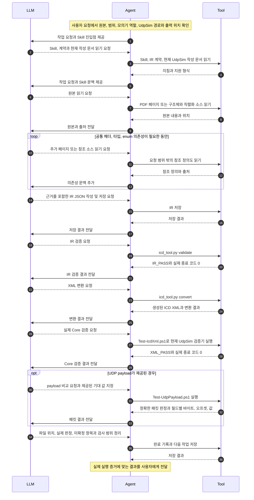
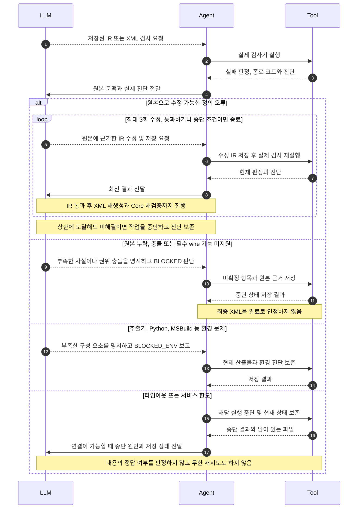
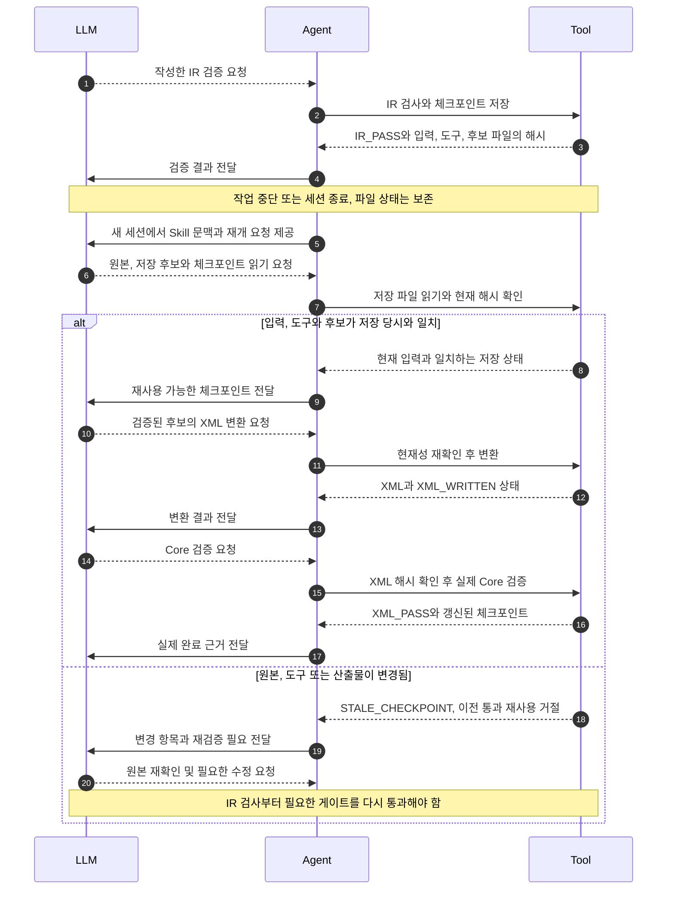

# LLM · Agent · Tool 상호작용

Agent는 LLM 호출, 도구 실행, 결과 전달과 작업 상태 관리를 맡는 실행 환경입니다.
Claude Code·Codex·OpenCode가 이 역할을 수행합니다. Skill의 지침과 계약은 Agent가 읽어 LLM의 문맥에 제공합니다.

| 역할 | 담당 |
| --- | --- |
| LLM | 원본 해석, 의존성 추적, IR 작성, 도구 선택, 근거에 따른 수정·중단 판단 |
| Agent | 문맥 구성, 도구 요청 실행, 실제 결과의 LLM 전달, 작업 진행·재개 |
| Tool | 파일/PDF 읽기, IR 검사·XML 변환, 실제 Core 검증, 선택적인 payload 검사와 상태 저장 |

아래 Tool은 사용 가능한 읽기/추출 도구와 이 Skill의 스크립트를 묶어 표시했습니다.
일반 사용은 Agent의 파일·셸 도구로 실행하고, 외부 QA에서는 제한된 MCP 어댑터를 사용할 수 있습니다.
MCP 어댑터가 사내 Skill 실행의 필수 구성 요소는 아닙니다.

## 1. 원본에서 검증된 XML까지

아래는 각 검증 게이트를 통과하는 정상 경로입니다. 게이트가 실패하면 다음 단계로 진행하지 않고
두 번째 다이어그램의 피드백 흐름으로 들어갑니다.

`IR_PASS`는 구현된 형식·일관성 검사 통과이며 원본 해석의 진실성까지 보장하지 않습니다.
XML 생성만으로 `XML_PASS`가 되지 않습니다. 실제 Core 종료 코드가 필요합니다.
payload 기대 값이 없으면 구조 해석만 확인하며, 일부 기대 값만 주면 그 부분만 비교합니다.
실제 캡처·장비 연결과 상대 장비의 정상 동작 확인은 이 흐름의 별도 작업입니다.

## 2. 오류 피드백, 정보 부족과 중단

LLM은 원본에 근거가 있는 오류만 수정합니다. 정보 부족과 환경 실패는 정의를 추측해 채우는 재시도 사유가 아닙니다.
Skill의 수정 상한은 메시지별 최대 3회입니다. QA MCP 어댑터는 최초 후보와 세 번의 실패한 수정 후보 이후 추가 검증을 제한합니다.

패킷 불일치는 원본·IR·XML·캡처와 기대 값을 대조할 계기입니다. 패킷에 맞추려고 정의를 무조건 바꾸지 않습니다.
또한 ID나 송수신 방향을 잘못 해석해도 형식 검사는 통과할 수 있습니다. 실제 QA의 독립 정답 대조는
호스트 평가자가 수행한 절차이며, 새 ICD의 정답을 Tool이 자동으로 만들어 주는 기능은 아닙니다.

## 3. 저장된 상태에서 재개

다음은 QA MCP 어댑터에 구현된 체크포인트 흐름입니다. 일반 Skill 사용에서도 입력/도구 기준과
산출물의 현재성을 확인해야 하지만, 모든 Agent 환경이 이 해시 게이트를 자동 제공하는 것은 아닙니다.

LLM은 파일 상태를 다시 읽어 이어갑니다. 이전 대화가 남아 있다는 가정이나 과거의 완료 문장만으로 재개하지 않습니다.

## 구현과 검증 근거

- [Skill 실행 계약](../../skills/udpsim-icd-authoring/SKILL.md), [오류 분류·수정·payload 흐름](../../skills/udpsim-icd-authoring/references/workflow.md)
- [IR 검사와 변환기](../../skills/udpsim-icd-authoring/scripts/icd_tool.py), [실제 Core 연결기](../../skills/udpsim-icd-authoring/scripts/Test-IcdXml.ps1)
- [패킷 검사기](../../skills/udpsim-icd-authoring/scripts/Test-UdpPayload.ps1), [QA MCP 어댑터의 상태 게이트](../../tools/udpsim_agent_mcp.py)
- [실행 모델과 부모 평가자의 범위를 구분한 자율 완주 QA](udpsim-codex-autonomous-qa.md), [분리본 검증 이력](../../PROVENANCE.md)

이 다이어그램은 현재 메시지 정의 흐름을 설명합니다. 전용 시나리오 XML 생성 QA나 사내 Qwen 인수 완료를 나타내지 않습니다.
